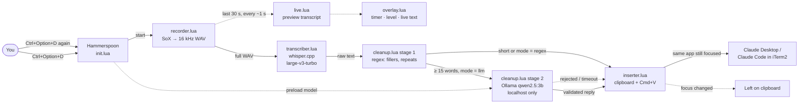
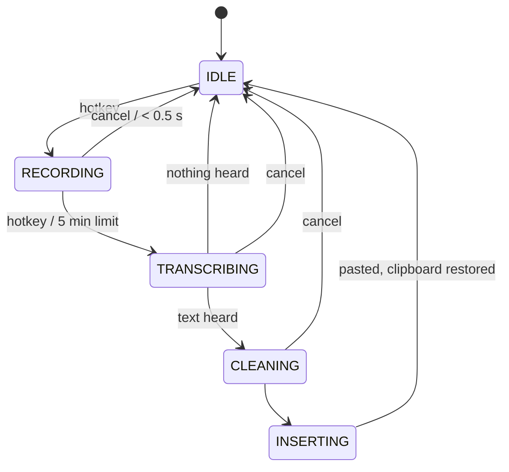

# voice-draft

Local dictation for macOS.

Press a hotkey, speak, and press it again. A cleaned-up transcript is pasted
into the app you were using, such as Claude Desktop or Claude Code in iTerm2.
It is never submitted, so you can review it first.

Everything runs on your Mac:

- [Hammerspoon](https://www.hammerspoon.org) handles the hotkey and the paste.
- [SoX](https://sox.sourceforge.net) records from the microphone.
- [whisper.cpp](https://github.com/ggml-org/whisper.cpp) does speech-to-text
  with `ggml-large-v3-turbo`.
- [Ollama](https://ollama.com) runs a small local model that removes filler
  words and false starts.

At runtime the tool makes one kind of network request: HTTP to Ollama on
`localhost:11434`. It refuses to start if the Ollama URL is not a loopback
address.

Requirements: an Apple Silicon Mac and [Homebrew](https://brew.sh).

## How it works



Solid lines are the main path; dotted lines are background work or fallbacks.
If the LLM reply is rejected or Ollama is unavailable, the stage 1 text is
pasted instead.

### State machine



## Install

```sh
git clone https://github.com/sameera207/voice-draft.git
cd voice-draft
./install.sh
```

The installer is idempotent, so you can re-run it safely. It does not use
`sudo`. It does the following:

1. Checks for Apple Silicon and Homebrew.
2. Installs `sox`, `whisper-cpp`, Hammerspoon and Ollama. Anything already
   installed is left alone.
3. Downloads the Whisper model (about 1.6 GB) to
   `~/.local/share/voice-draft/models/` and verifies its SHA-256.
4. Starts Ollama and pulls `qwen2.5:3b`.
5. Symlinks `hammerspoon/dictation` to `~/.hammerspoon/dictation`.
6. Appends `require("dictation")` to `~/.hammerspoon/init.lua` if that line
   isn't there. Nothing else in the file is changed.
7. Runs the doctor.

Installer options are set with environment variables:

| Variable | Effect |
| --- | --- |
| `OLLAMA_MODEL=llama3.2:3b` | Pull a different cleanup model. You also need to set it in overrides. |
| `WHISPER_MODEL=ggml-large-v3-turbo-q5_0.bin` | Download a quantized Whisper model instead (about 0.6 GB). You also need to set `paths.model`. |
| `SKIP_WHISPER_MODEL=1` | Skip the Whisper download. |

### Grant permissions

Open **System Settings → Privacy & Security** and enable Hammerspoon under:

- **Accessibility**, needed to send Cmd+V. The hotkeys stay disabled until
  this is granted.
- **Microphone**, needed for recording. macOS asks for it the first time you
  record.

Then check the setup from the Hammerspoon console (menu bar icon → Console):

```lua
dictation.doctor()
```

All checks should show `PASS`.

## Usage

| Hotkey | Action |
| --- | --- |
| **Ctrl+Option+D** | Start recording. Press again to stop, transcribe, clean up and paste. |
| **Ctrl+Option+Shift+D** | Cancel. Discards the audio and inserts nothing. |

While you dictate, a floating panel near the bottom of the screen shows:

- a pulsing red dot, the elapsed time and a live microphone level meter
- a **live transcript** that updates every couple of seconds as you speak
- the current stage after you stop ("Transcribing…", "Cleaning up…")

The live transcript is a preview. It comes from re-running Whisper on the
last 30 s of audio, so it can lag a little or change as you go. The pasted
text always comes from the full recording, cleaned up as usual. Set
`ui.live_text = false` to show only the dot, timer and level meter, which
also saves GPU and battery. Set `ui.overlay = false` to turn the panel off
completely.

The menu bar icon also shows the current state: 🎙 idle, 🔴 recording, ⏳ working.
Its menu also lets you switch the cleanup mode for the current session and
run the doctor.

How it behaves:

- The text goes to the app that was focused when you stopped recording. If
  you switch apps before the text is ready, it is left on the clipboard and
  you'll see "Dictation ready on clipboard".
- Your clipboard is saved before the paste and restored about 300 ms after.
  The pasted transcript is marked transient, so clipboard managers skip it.
- Enter is never pressed.
- Recordings shorter than 0.5 s are discarded. Recording stops automatically
  after 5 minutes and the transcript is still pasted.
- Silence shows "Nothing heard". Whisper's stock hallucinations, such as
  `[BLANK_AUDIO]` or a lone "Thank you.", are filtered out.
- The temp WAV file is deleted after transcription.

## Cleanup

| `cleanup.mode` | What happens |
| --- | --- |
| `off` | Raw Whisper text. Only artifact tags are removed. |
| `regex` | Stage 1 only: a fast, deterministic pass. |
| `llm` (default) | Stage 1, then stage 2 (Ollama) if the text has at least `llm_min_words` (15) words. |

**Stage 1** (`cleanup.stage1`, pure Lua):

- Strips Whisper tags.
- Removes `um`, `uh`, `uhm`, `er`, `erm`, `ah` and `hmm`. It keeps "like"
  and "so".
- Removes "you know" and "I mean" when they are set off by commas, or start
  a sentence and are followed by a comma.
- Collapses repeated words and short phrases ("the the", "I want to I want
  to").
- Joins stray line breaks, fixes spaces before punctuation, and capitalizes
  the first letter.
- Never touches code-like tokens: paths, flags, identifiers, numbers or
  anything in backticks.

**Stage 2** sends the stage 1 text to Ollama with the prompt in
`prompts/cleanup_system.txt` and two few-shot examples. The transcript is
wrapped in `<transcript>` tags. The reply is rejected, and stage 1 text is
used instead, if it:

- is empty
- starts with a preamble such as "Sure" or "Here is"
- is shorter than 40% or longer than 130% of the input, counted in words

Matching quotes or tags around the reply are stripped before these checks.
If Ollama is down, the model is missing or the request takes longer than
8 s, you get stage 1 text and an alert explaining why.

The model is preloaded when you start recording, with `keep_alive` set to
30 minutes, so it is warm by the time you stop.

## Configuration

Defaults live in `hammerspoon/dictation/config.lua`. Put your changes in
`~/.config/voice-draft/overrides.lua`, which is merged on top of the
defaults and is never touched by upgrades. Only include the keys you want to
change:

```lua
-- ~/.config/voice-draft/overrides.lua
return {
  cleanup = { ollama = { model = "gemma4:latest", think = false } },
  vocabulary = { "Claude Code", "MCP", "Hammerspoon", "worktree", "Kubernetes" },
  ui = { sounds = true },
}
```

Reload Hammerspoon after editing the file.

| Key | Default | Notes |
| --- | --- | --- |
| `hotkey_toggle` | `{mods={"ctrl","alt"}, key="d"}` | |
| `hotkey_cancel` | `{mods={"ctrl","alt","shift"}, key="d"}` | |
| `paths.sox`, `paths.whisper` | `nil` (auto-detect) | Looks in `/opt/homebrew/bin`, then `/usr/local/bin`. |
| `paths.model` | `~/.local/share/voice-draft/models/ggml-large-v3-turbo.bin` | |
| `paths.tmp_wav` | `/tmp/voice-draft.wav` | |
| `recording.min_seconds` / `max_seconds` | `0.5` / `300` | |
| `whisper.language` | `"en"` | `"auto"` detects the language. |
| `whisper.threads` | `nil` | `nil` uses the whisper-cli default. |
| `whisper.extra_args` | `{}` | Extra flags passed to whisper-cli. |
| `whisper.timeout_seconds` | `120` | |
| `vocabulary` | Claude Code, MCP, … | Passed to Whisper as its initial prompt (first 12 terms) and to the LLM as known terms. |
| `cleanup.mode` | `"llm"` | `"off"`, `"regex"` or `"llm"`. |
| `cleanup.llm_min_words` | `15` | Shorter dictations skip the LLM. |
| `cleanup.ollama.url` | `http://localhost:11434` | Must be a loopback address. |
| `cleanup.ollama.model` | `"qwen2.5:3b"` | |
| `cleanup.ollama.keep_alive` | `"30m"` | |
| `cleanup.ollama.timeout_seconds` | `8` | |
| `cleanup.ollama.preload_on_record` | `true` | |
| `cleanup.ollama.think` | `nil` | Set to `false` for thinking models such as qwen3 or gemma4. |
| `insert.restore_clipboard_after_ms` | `300` | |
| `insert.require_same_app` | `true` | |
| `ui.menubar` / `alerts` / `sounds` | `true` / `true` / `false` | |
| `ui.overlay` | `true` | Floating panel with timer, level meter and status. |
| `ui.live_text` | `true` | Live preview transcript in the panel. Runs Whisper repeatedly while you record. |
| `ui.live_text_interval` | `1.0` | Seconds to wait between preview runs. |
| `ui.live_text_window` | `30` | The preview transcribes only the last N seconds. |
| `debug` | `false` | Logs timings and errors to `~/Library/Logs/voice-draft.log`. |
| `log_text` | `false` | With `debug`, also logs transcripts. |
| `keep_audio` | `false` | Keeps the temp WAV after transcription. |

### Changing the cleanup model

```sh
ollama pull llama3.2:3b
```

Then set `cleanup = { ollama = { model = "llama3.2:3b" } }` in overrides and
reload Hammerspoon. Models worth comparing: `qwen2.5:3b`, `llama3.2:3b` and
`gemma3:4b`. If quality matters more than speed, try a 7B or 8B model. A
32 GB M-series Mac runs those comfortably.

## Tests

```sh
lua tests/cleanup_spec.lua     # or: luajit tests/cleanup_spec.lua
```

The tests cover stage 1, LLM output validation, request building, Whisper
output filtering and config merging. They need no Hammerspoon.

## Measured latency

Measured on an Apple M5 with 32 GB of RAM. Every dictation prints a timing
line to the Hammerspoon console:

```
[dictation] audio 30.2s | transcribe 2.10s | cleanup 1.40s (llm) | total 3.60s
```

Measured on 2026-10-12 with a 34 s rambling dictation (synthesized with
`say`, with fillers, a restart and a question) run through the real
modules inside Hammerspoon. The totals add up the stage timings plus the
300 ms clipboard-restore wait.

| Scenario | Transcribe | Cleanup | Total (stop to paste) |
| --- | --- | --- | --- |
| 34 s dictation, `regex` mode | 1.96 s | <0.01 s | ≈2.3 s |
| 34 s dictation, `llm` mode (`qwen2.5:3b`, warm) | 1.96 s | 1.89 s | ≈4.2 s |
| First dictation after Hammerspoon starts | 8.6 s | — | — |

The first transcription after Hammerspoon starts is slower while the model
file and Metal kernels load. Later runs use the warm figures above.

## Troubleshooting

Start with `dictation.doctor()` in the Hammerspoon console.

- **Nothing happens on the hotkey.** Accessibility isn't granted, or another
  app owns Ctrl+Option+D. Check the console for alerts.
- **"Nothing heard" every time.** Microphone permission is probably denied,
  so SoX records silence. Enable Hammerspoon under Privacy & Security →
  Microphone, then quit and reopen Hammerspoon. To test recording outside
  Hammerspoon, run `sox -d -r 16000 -c 1 -b 16 /tmp/t.wav` in a terminal and
  press Ctrl+C to stop.
- **"Cleanup unavailable".** Run `ollama serve` (or
  `brew services start ollama`) and `ollama pull <model>`. Dictation still
  works with regex cleanup in the meantime.
- **The LLM changed my meaning.** Lower `cleanup.mode` to `"regex"`, raise
  `llm_min_words`, or try another model. Rejected LLM replies are logged
  when `debug = true`.
- **Pasted into the wrong place.** The paste goes to the app that was
  focused when recording stopped. If focus changes, the text is left on the
  clipboard.
- **The first transcription is slow.** whisper.cpp compiles its Metal
  shaders on the first run after an install or upgrade. Later runs are
  faster.
- **Logs.** Set `debug = true` in overrides. The log is at
  `~/Library/Logs/voice-draft.log`.

## Uninstall

```sh
rm ~/.hammerspoon/dictation
```

Then delete the `require("dictation")` line from `~/.hammerspoon/init.lua`.
To reclaim disk space, also run `rm -r ~/.local/share/voice-draft` and
`ollama rm qwen2.5:3b`.
