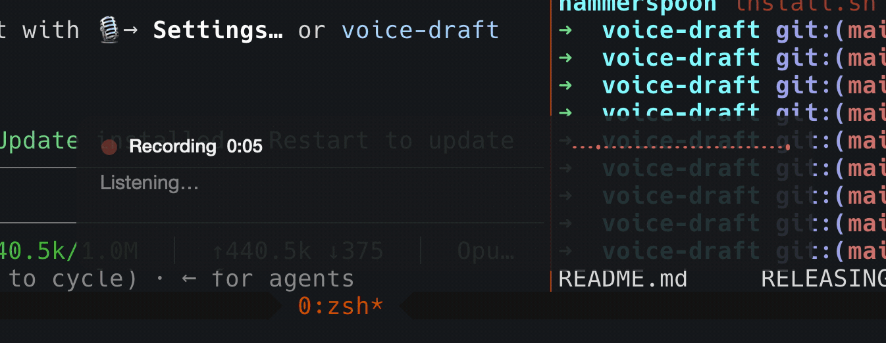
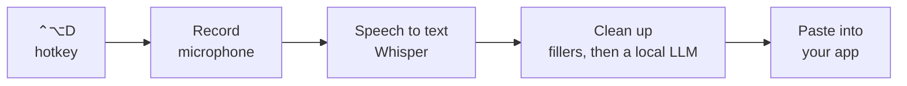
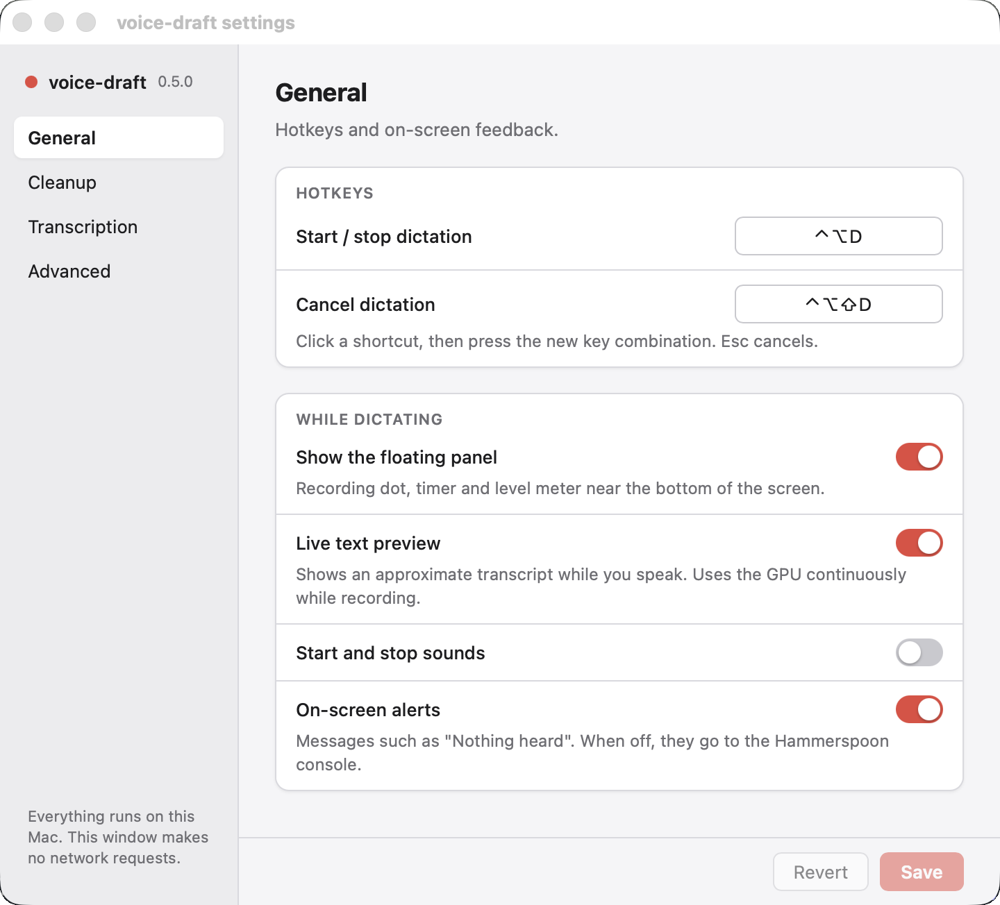
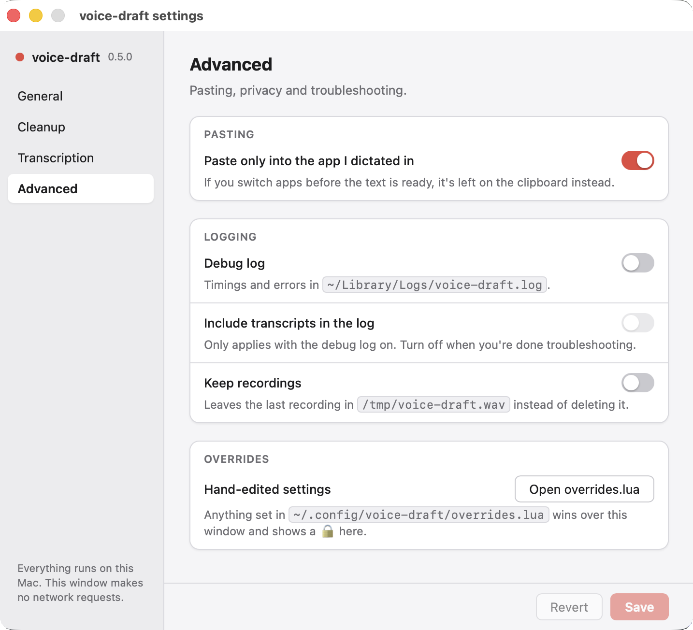

# voice-draft

Private dictation for macOS. Press a hotkey, speak, and press it again. A
cleaned-up transcript is pasted into the app you were using, such as Claude
Desktop or a terminal. It's never sent, so you can review it first.

Everything runs on your Mac. No accounts, no cloud.



## How it works



1. **Record:** SoX records your microphone while you speak.
2. **Speech to text:** [whisper.cpp](https://github.com/ggml-org/whisper.cpp)
   turns the audio into text.
3. **Clean up:** a quick pass removes "um", "uh" and repeated words. Then a
   small local LLM, run by [Ollama](https://ollama.com), fixes false starts
   and punctuation without changing what you meant.
4. **Paste:** the text goes into the app you were in. Enter is never pressed.

[Hammerspoon](https://www.hammerspoon.org) ties the steps together.

## Install

You need an Apple Silicon Mac and [Homebrew](https://brew.sh).

```sh
brew install sameera207/tap/voice-draft
voice-draft setup
```

`setup` installs Hammerspoon and Ollama if you don't have them. It also
downloads the speech model (about 1.6 GB) and the cleanup model (about
2 GB). It's safe to run again.

Then open **System Settings → Privacy & Security** and allow Hammerspoon
under **Accessibility** and **Microphone**. Check everything is ready with:

```sh
voice-draft doctor
```

## Use

| Hotkey | Action |
| --- | --- |
| **⌃⌥D** (Ctrl+Option+D) | Start recording. Press again to stop and paste. |
| **⌃⌥⇧D** (Ctrl+Option+Shift+D) | Cancel and discard the recording. |

While you speak, a small panel shows a live preview of the text. A
30-second dictation is usually pasted about 4 seconds after you stop.

The hotkeys work while Hammerspoon is running. It starts at login, and
`voice-draft keepalive on` reopens it automatically if it's ever quit. Use
`voice-draft stop` and `voice-draft start` to turn dictation off and on.

## Settings

Click the 🎙 icon in the menu bar. The menu has quick switches for the
cleanup model, cleanup mode and speech model. **Settings…** opens the
window below; `voice-draft config` opens it from the terminal.

<p>
  
  
</p>

| Tab | What you can change |
| --- | --- |
| **General** | Hotkeys (click one and press a new combination), the floating panel, the live preview, sounds. |
| **Cleanup** | Off, Quick or Full cleanup; which LLM to use; pulling new ones from Ollama; your vocabulary of names and technical terms. **Test cleanup** shows the result on sample text before you switch. |
| **Transcription** | Which Whisper model to use, with one-click downloads, from tiny (fast) to large-v3-turbo (most accurate). Also language. |
| **Advanced** | Paste behaviour, logging, and a link to `overrides.lua`. |

Changes apply right away. They're saved in
`~/.config/voice-draft/settings.json`. For anything the window doesn't
cover, add it to `~/.config/voice-draft/overrides.lua`, which takes
priority. See [all settings](docs/reference.md#settings).

## Updating

```sh
voice-draft update            # update now
voice-draft autoupdate on     # or check once a day (off by default)
```

## Uninstall

```sh
voice-draft uninstall
brew uninstall voice-draft
```

## More

[docs/reference.md](docs/reference.md) has the details:

- every setting and command
- how cleanup works
- the Whisper model list
- measured latency
- troubleshooting
- developing from source

## License

[MIT](LICENSE) © 2026 sameera207.

voice-draft builds on other open-source projects, each under its own
license: [Hammerspoon](https://www.hammerspoon.org) (MIT),
[whisper.cpp](https://github.com/ggml-org/whisper.cpp) (MIT),
[Ollama](https://ollama.com) (MIT), [SoX](https://sox.sourceforge.net)
(GPL/LGPL) and the Whisper and Ollama models, which you download
separately under their own terms.
